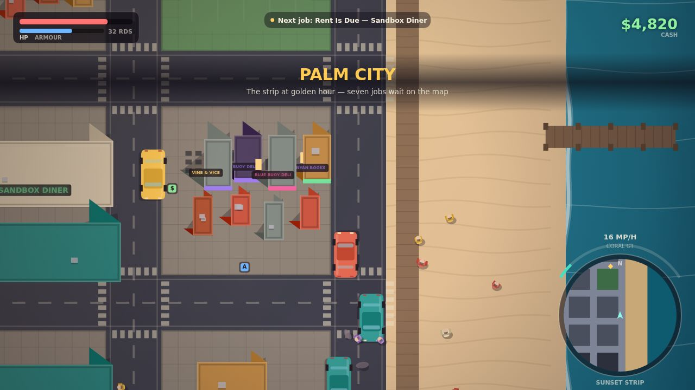
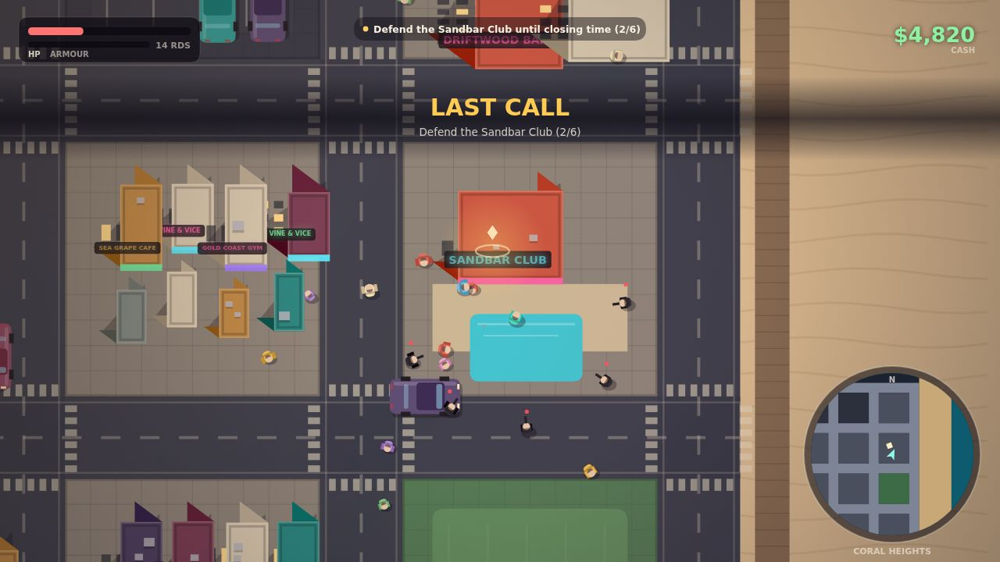

[](https://make.fun/bounty/gta6-01?utm_source=github&utm_medium=readme&utm_campaign=gta6-01)
[](https://make.fun/bounty/gta6-01/leaderboard?utm_source=github&utm_medium=readme&utm_campaign=gta6-01)
[](https://make.fun/bounty/gta6-01?utm_source=github&utm_medium=readme&utm_campaign=gta6-01)

# Palm City

A top-down open-world crime game that runs in a browser tab: one canvas, no dependencies, no
network requests, no build step. A [make.fun](https://make.fun) bounty entry — every line of
city, script, art and sound was written for this repo.

You arrive on the Sunset Strip with a beater and a tab you can't pay. Rosa at the Sandbox Diner
has seven jobs for you — a lock-up pickup, a pawn ticket, a marina run, an arcade debt, a hotel
room, a club that needs defending, and the long pier at the end of it. Between jobs the city
keeps score: sirens answer gunfire, cruisers box you in, and the stars over your head only cool
when you actually break line of sight.



## What's in it

- **A real city grid.** 7×7 blocks, 3260×3260 units, seeded once (mulberry32) so the same town
  grows every run: towers and shop rows with extruded walls and lit windows, parks, parking lots,
  a beach, a boardwalk, palms and a pier. Nothing is tiled from an atlas — it's all drawn with
  canvas paths and flat colour, lit by one low sun from the north-west.
- **Driving.** Eight car models with arcade physics: throttle fights drag, steering only bites
  while rolling, the handbrake lets the tail step out, walls dent the bodywork and cost speed.
  Parked cars are hot-wirable (`E`), traffic cars hold lanes, brake for what's ahead and take
  bezier turns at junctions.
- **On foot.** Walk, sprint, punch, shoot. Pedestrians wander, flinch and scatter; cars run them
  over. Building collision is circle-vs-rect with slide, so you brush along walls instead of
  sticking.
- **Police with memory.** Crimes add heat — a bumped pedestrian is a fraction of a star, a dead
  officer is most of two. Stars buy cruisers that chase, cut you off and bail out on foot with
  pistols drawn. Sit still surrounded and you're BUSTED; bleed out and you're WASTED, waking at
  the park with a hospital bill.
- **Seven missions.** Each has a giver, a briefing card, a reach/defend/chase objective, a HUD
  marker and a payout, chained across the map from the diner to the pier.
- **HUD and map.** Health/armour bars, cash, ammo, wanted stars, a scrolling objective line, a
  live circular minimap that draws the real block layout and every marker, and a speedometer.
- **Sound with no sound files.** WebAudio synthesises the lot: an engine whose pitch tracks road
  speed, a two-tone siren sweep, gunshots, pickups, UI clicks and a slow synthwave bass loop.
- **Screens.** Title art, pause menu (resume/save/load/controls), a controls card, mission
  briefing, and the wasted/busted cards. Progress saves to `localStorage`.




## Controls

| Input | On foot | In a car |
| --- | --- | --- |
| `W A S D` / arrows | walk | throttle / brake, steer |
| `Shift` | sprint | boost |
| `Mouse` | aim | steer toward the cursor while held |
| `F` or left click | fire | fire out of the window |
| `Space` | punch | handbrake |
| `E` | enter the nearest car, start a job | get out |
| `Esc` / `P` | pause (save, load, controls) | same |
| `H` | controls card | controls card |
| `M` | music on/off | music on/off |
| `G` | quick save | quick save |
| `Enter` | confirm on menus, respawn when dead | same |

## Run it

```
node serve.ts            # serves game/ on http://localhost:8080
node serve.ts --port 8895
```

Then open the printed address in a desktop browser. Any static file server works — the game is
`game/index.html` plus its classic scripts in `game/src/`; there is no bundler and no npm install.

Hand-in check (what the grader runs):

```
mkdir -p out && MAKEFUN_OUTPUT_DIR=out node main.ts    # writes out/game, out/screenshots, out/dossier.json
```

`shots.json` lists the four staged scenes the screenshots come from; append `?shot=1..4&frames=120`
to the served URL to reproduce any of them deterministically.

## Layout

```
game/index.html      page, boot screen, script order
game/src/            config, city, streets, world, entities, vehicles, traffic,
                     police, combat, missions, effects, hud, ui, audio, render, shots
main.ts              hand-in: copies game/ + screenshots/, writes dossier.json
serve.ts             tiny static server for local play
screenshots/         the four renders above, straight from the running game
vendor/              the make.fun dossier library (vendored, untouched)
```

## Look

Deliberately flat and warm: *Miami Vice* dusk palette, the camera language of the first two
*Grand Theft Auto* games and *Driver* (1999), and the extruded-block trick of Japanese city
illustration — buildings lean away from the sun so the streets read as canyons without a 3D
engine. Type and HUD panels follow the same cream-on-ink scheme as the in-game menus.

## License

MIT — see `LICENSE`.
