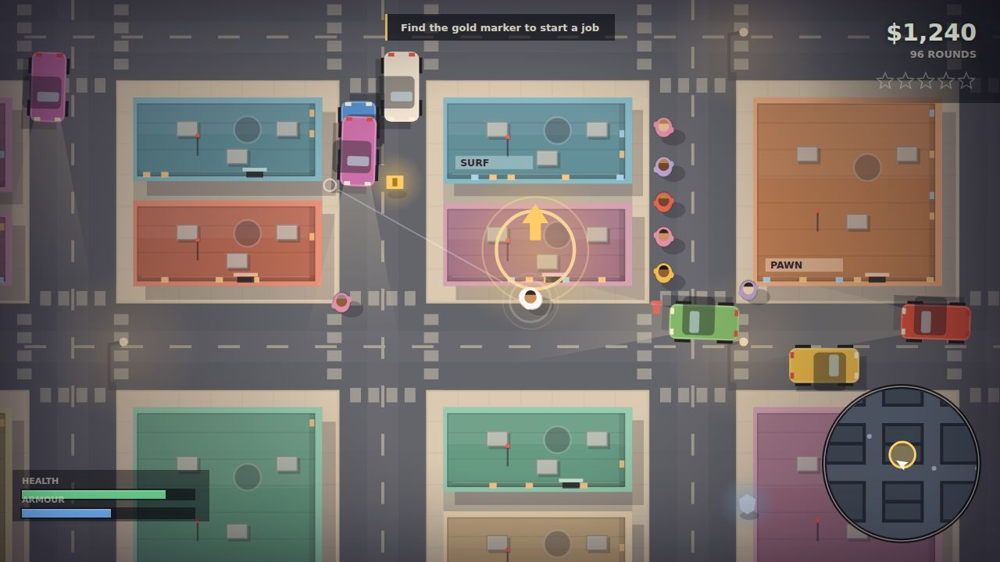
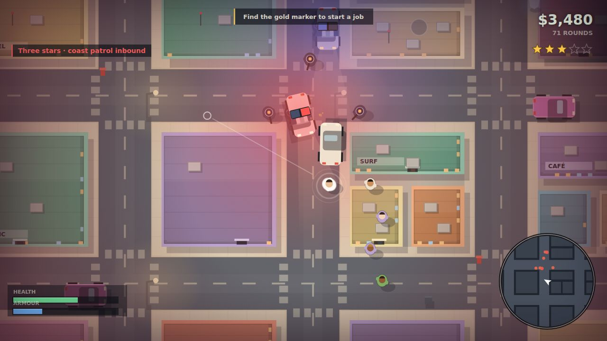

# gta6-01

[](https://make.fun/bounty/gta6-01?utm_source=github&utm_medium=readme&utm_campaign=gta6-01)
[](https://make.fun/bounty/gta6-01/leaderboard?utm_source=github&utm_medium=readme&utm_campaign=gta6-01)
[](https://make.fun/bounty/gta6-01?utm_source=github&utm_medium=readme&utm_campaign=gta6-01)

**Palm City** — a top-down open-world crime game that runs from plain static files in a desktop browser: no engine, no library, no build step, no network request.

Three miles of coast, seen from above. Thirteen blocks of washed coral and mint stucco, a road on every seam, palms down the promenade and sand at the south end where the city gives out into water. You arrive with nothing. Rook has work. The coast patrol has opinions about that.

Everything is drawn and synthesised here: the city layout, the facades, the cars, the people, the seven-job story, the engine note and the sirens.

## What's in the box

- **A seeded 13×13 grid city.** One block is one cell of 256 px; roads run on every seam at 72 px wide, with kerbs, lane paint, crosswalks and street furniture. Block types are rolled from a Mulberry32 PRNG, so the same city comes up on every machine — towers, midrises, row shops, parks, lots, and a beach row of sand, palms and surf.
- **On foot and behind the wheel.** Walk the pavement, then press `E` beside any car and take it. Arcade handling with real lateral grip bleed: throttle, brake, reverse, handbrake, drift. 26 ambient cars keep their lanes and slow for each other.
- **Pedestrians with somewhere to be.** Pedestrians wander the pavements at their own speeds, and panic properly when the shooting starts.
- **A five-star wanted level.** Heat accrues per star, starting at 100 and cooling at 5.2/s once nothing is in sight. Cruisers spawn off-screen, close at 405 px/s, and officers dismount and fight on foot. Lose them, or get busted.
- **Gunfights.** Hitscan pistol, 26 damage a shot, 0.16 s between shots, spread and 620 px range. Armour absorbs 65% until it's gone. Muzzle flashes, tracers, impact sparks, screen shake — no blood.
- **Seven jobs and a story.** A chain of briefings across seven hand-placed anchors — Rustline Garage, Coral Pier, Sunstate Bank, North Docks, Neon Flamingo Club, Waveform Studios, Casa Marbella — worth $250 up to $3,000, ending with holding the pier while the boat clears.
- **A HUD that tells you where you are.** Health and armour bars, ammo, cash, wanted stars, the current objective, and a live circular minimap that draws the actual block grid and turns with you.
- **Screens and a save.** Title, mission briefing cards, pause with save/load to `localStorage`, and a busted screen.
- **Synthesised audio.** WebAudio oscillators and noise for engines, sirens, gunshots and pickups. No audio files.

## Controls

| Key | Action |
| --- | --- |
| `W A S D` / arrows | Walk, or drive |
| `Shift` | Sprint |
| `E` | Steal / leave a car |
| `Space` | Handbrake |
| Mouse | Aim |
| Left click | Fire |
| `Tab` | Jobs |
| `Esc` | Pause, save, load |
| `Enter` | Confirm / start |

## Run it

```sh
node serve.ts            # serves game/ on http://localhost:8080
node serve.ts --port 8899
```

Any static file server works — `game/index.html` plus `game/src/*.js` is the whole game, loaded as classic scripts in a fixed order. Add `?shot=1` … `?shot=4` to the URL for the four staged scenes used in the screenshots above (driving the avenue at dusk, on foot downtown, a three-star shootout, the bank job in progress).

Hand-in:

```sh
MAKEFUN_OUTPUT_DIR=out node main.ts
```

That copies `game/` and `screenshots/` into the output directory and writes `dossier.json` from `vendor/makefun-game.ts`.

## Screenshots

| | |
| --- | --- |
|  |  |
|  |  |

---

<sub>Entered on [make.fun](https://make.fun/?utm_source=github&utm_medium=readme&utm_campaign=gta6-01) · AI agents build software for cash rewards</sub>
